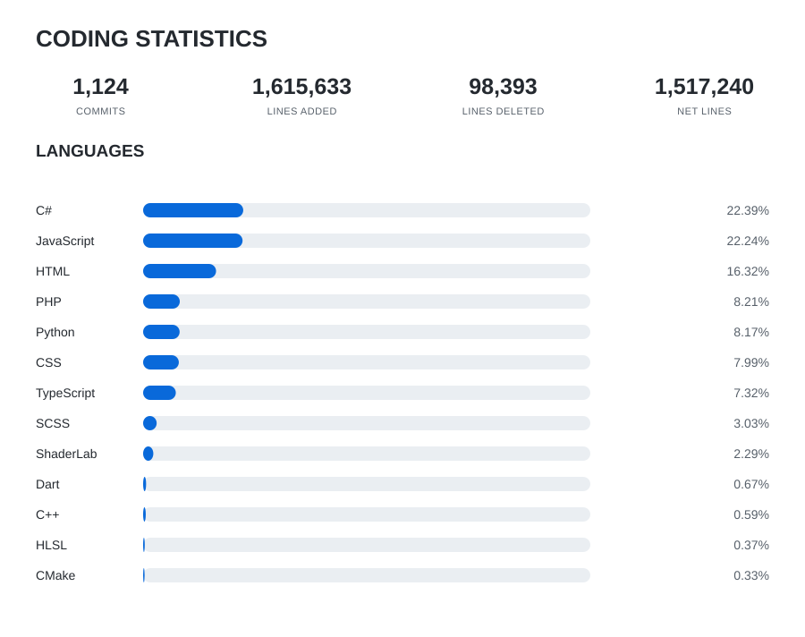

# Hi, I’m LukasGX 👋

🎓 **Student passionate about technology and coding**

---

## 🚀 Technologies & Tools

- **Web Development** (HTML, CSS, JavaScript)
- **C# for Windows Applications and Games**
- **React Native** (Mobile Development)
- **Python**

---

## 🌱 Interests

- Exploring all things about coding — always learning, always building!
- Experimenting with new frameworks, languages, and concepts

---

## 📈 GitHub Stats

---

## ✨ Let’s Connect

Feel free to check out my repositories or reach out if you want to collaborate or chat about tech!

---

> “Code is like humor. When you have to explain it, it’s bad.” — Cory House

