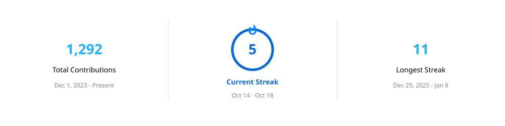

# Hi, I'm Lukas 👋

I'm a student from Germany who spends a probably unreasonable amount of time building things with code.

Most of my projects are experiments, tools, or things I needed myself. I like figuring out how stuff works and then inevitably overengineering it.

## What I work with

**Languages**

**Technologies & Tools**

## Some of my projects

### GXCode

My own programming language and interpreter written in C#/.NET.

### DecisionTreeGenerator

A decision-tree generator written in C#, supporting different data formats and configurable schemas.

### OwnWiki

A wiki system I built myself, inspired by MediaWiki.

## A few things about me

- 🐧 Proud linux user
- 🇳🇴 Currently learning Norwegian
- 🧗 I like climbing
- 🔧 I enjoy building things just to see if I can
- 📚 Spending way too much time programming

---

> *If it works, it's probably not overengineered enough.*

